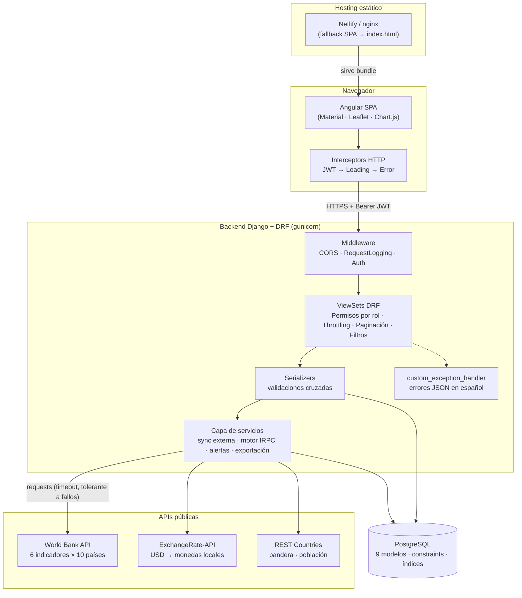

# DataPulse Latam

Plataforma fullstack de consultoría financiera para monitorear indicadores macroeconómicos de 10 países latinoamericanos, calcular el **Índice de Riesgo País Compuesto (IRPC)**, gestionar portafolios de inversión y generar alertas automáticas.

| Capa | Tecnología |
| :--- | :--- |
| Backend | Python 3.13 · Django 5.2 · Django REST Framework 3.18 · SimpleJWT · drf-spectacular |
| Frontend | Angular 22 (standalone, `strict`) · Angular Material · Leaflet · Chart.js (ng2-charts) |
| Base de datos | PostgreSQL 15 (SQLite como respaldo para desarrollo y pruebas locales) |
| Infraestructura | Docker / Docker Compose · Render (API + BD) · Netlify (SPA) · GitHub Actions (CI) |

## Despliegue en la nube

| Componente | URL |
| :--- | :--- |
| **Frontend SPA** | https://datapulse-frontend-christian-martinez.netlify.app/ |
| **Backend API** | https://datapulse-backend-11qv.onrender.com/api/ |
| **Swagger UI** | https://datapulse-backend-11qv.onrender.com/api/docs/ |

> **Nota:** el backend y la base de datos corren en la **capa gratuita de Render**. Tras unos 15 minutos sin tráfico el servicio se suspende, y la primera petición puede tardar **unos 30 segundos** mientras el contenedor vuelve a arrancar. Si el login no responde al primer intento, espere unos segundos y reintente.

## Credenciales de prueba

Todos los usuarios usan la contraseña **`DataPulse2026!`**. El comando `seed_data` los crea en cada arranque y es idempotente.

| Usuario | Rol | Permisos |
| :--- | :--- | :--- |
| `admin@datapulse.com` | `ADMIN` | Todo lo del analista. También puede sincronizar indicadores desde APIs externas (`POST /api/paises/sync-indicadores/`), recalcular el IRPC (`POST /api/riesgo/calcular/`) y leer o editar cualquier portafolio. |
| `analista@datapulse.com` | `ANALISTA` | Crea, edita y elimina sus portafolios y posiciones. Consulta países, riesgo, dashboard y alertas. Exporta PDF y XLSX. |
| `viewer@datapulse.com` | `VIEWER` | Solo lectura. La API responde `403` si intenta crear o editar portafolios, y el frontend oculta esos botones. |

---

## Tabla de contenidos

1. [Arquitectura de la solución](#1-arquitectura-de-la-solución)
2. [Modelo de datos](#2-modelo-de-datos)
3. [Decisiones técnicas y alternativas consideradas](#3-decisiones-técnicas-y-alternativas-consideradas)
4. [Instalación y ejecución local](#4-instalación-y-ejecución-local)
5. [Ejecución de pruebas y linter](#5-ejecución-de-pruebas-y-linter)
6. [Documentación de la API](#6-documentación-de-la-api)
7. [Manejo de errores, observabilidad y seguridad](#7-manejo-de-errores-observabilidad-y-seguridad)
8. [Estructura del repositorio](#8-estructura-del-repositorio)

---

## 1. Arquitectura de la solución

El sistema sigue una arquitectura cliente-servidor desacoplada: una **SPA Angular** consume una **API REST stateless** autenticada con JWT, y la API persiste en **PostgreSQL** e integra tres APIs públicas externas.



### Capas

| Capa | Responsabilidad | Ubicación |
| :--- | :--- | :--- |
| **Presentación (SPA)** | Componentes standalone con lazy loading por feature (`auth`, `dashboard`, `paises`, `portafolios`, `alertas`), `authGuard` y `roleGuard`, formularios reactivos con validación síncrona y asíncrona. | `frontend/src/app/modules/`, `shared/` |
| **Núcleo del cliente** | Servicios HTTP tipados, interfaces TS estrictas, interceptors y estado reactivo con `BehaviorSubject`. | `frontend/src/app/core/` |
| **API / transporte** | Routers DRF, ViewSets, permisos por rol, throttling, paginación, filtros (`django-filter`), búsqueda y ordenamiento. | `backend/apps/*/views.py`, `urls.py` |
| **Validación** | Serializers con las reglas de negocio: unicidad de nombre, límites de monto, reglas cruzadas de posiciones y bloqueo optimista. | `backend/apps/*/serializers.py` |
| **Dominio / servicios** | Clientes de APIs externas, motor IRPC puro (sin acceso a BD), generación de alertas y exportación PDF/XLSX. | `services.py`, `risk/irpc.py`, `portfolios/exportacion.py` |
| **Persistencia** | Modelos normalizados, `UniqueConstraint` / `CheckConstraint`, índices sobre los campos más filtrados y migraciones versionadas. | `backend/apps/*/models.py`, `migrations/` |
| **Transversal** | Middleware de logging de requests, auditoría en `LogActividad`, manejador de excepciones y `seed_data`. | `backend/apps/core/` |

### Ciclo de vida de un request (ejemplo: `PUT /api/portafolios/7/`)

1. **Angular:** el formulario reactivo valida en el cliente. Si es inválido, no se envía nada. Si es válido, `PortafolioService` envía el cuerpo junto con la `fecha_modificacion` que conoce.
2. **`jwtInterceptor`** añade `Authorization: Bearer <access>`, **`loadingInterceptor`** activa el spinner global y **`errorInterceptor`** queda escuchando la respuesta.
3. **Django:** el request pasa por `CorsMiddleware`, `RequestLoggingMiddleware` (que mide la duración) y la autenticación JWT de DRF. Después se aplican el throttle (100 req/min) y los permisos `PuedeEditarPortafolios` (rol) y `EsPropietarioOPublico` (objeto).
4. **Serializer:** valida los campos y compara la versión. Si la `fecha_modificacion` no coincide, responde **409**.
5. **ORM → PostgreSQL:** `UPDATE` con las constraints de BD como última barrera. `AuditoriaMixin` registra `EDITAR` en `LogActividad`.
6. **Respuesta:** JSON `200`, o el error en el formato estandarizado. El interceptor muestra un `MatSnackBar` en español, o redirige al login ante un `401`.

### Tareas en background

Las tres tareas de §6.1 están implementadas como **servicios invocables** desde endpoints de administración y desde `seed_data`. No se usa Celery, para mantener el stack gratuito con un solo proceso.

| Tarea | Servicio | Disparador |
| :--- | :--- | :--- |
| Sincronización de indicadores (10 países × 6 indicadores World Bank) | `countries.services.sincronizar_indicadores` | `POST /api/paises/sync-indicadores/` (ADMIN) |
| Actualización de tipos de cambio y variación diaria (alerta si supera el 3 %) | `countries.services.actualizar_tipos_cambio` | Se ejecuta dentro de la misma sincronización |
| Recálculo del IRPC, comparación con el cálculo anterior y alertas | `risk.services.recalcular_todos` | Tras la sincronización y en `POST /api/riesgo/calcular/` (ADMIN) |

Cada país y cada indicador se consultan de forma aislada. Un timeout, un error HTTP o un valor `null` de la API externa se registran en el log (`ERROR`) y en el resultado de la sincronización, sin abortar el resto del proceso (escenario de prueba 1).

---

## 2. Modelo de datos

```mermaid
erDiagram
    USUARIO ||--o{ PORTAFOLIO : "crea"
    USUARIO |o--o{ ALERTA : "recibe (null = global)"
    USUARIO |o--o{ LOG_ACTIVIDAD : "genera"
    PAIS ||--o{ INDICADOR_ECONOMICO : "tiene"
    PAIS ||--o{ TIPO_CAMBIO : "cotiza (via moneda_codigo)"
    PAIS ||--o{ INDICE_RIESGO : "evaluado en"
    PAIS ||--o{ ALERTA : "origina"
    PAIS ||--o{ POSICION : "destino de"
    PORTAFOLIO ||--o{ POSICION : "contiene"

    USUARIO {
        bigint id PK
        string email UK "campo de login (USERNAME_FIELD)"
        string nombre_completo
        enum rol "ADMIN | ANALISTA | VIEWER (indexado)"
        datetime fecha_creacion
        bool activo
    }
    PAIS {
        char2 codigo_iso PK "CO, BR, MX..."
        string nombre
        char3 moneda_codigo UK "COP, BRL..."
        string moneda_nombre
        enum region "ANDINA | CONO_SUR | CENTROAMERICA | CARIBE"
        decimal latitud "CHECK -90..90"
        decimal longitud "CHECK -180..180"
        bigint poblacion
        url bandera_url
        bool activo
    }
    INDICADOR_ECONOMICO {
        bigint id PK
        char2 pais_id FK
        enum tipo "PIB | INFLACION | DESEMPLEO | BALANZA_COMERCIAL | DEUDA_PIB | PIB_PERCAPITA"
        decimal valor
        enum unidad "PORCENTAJE | USD | USD_MILES_MILLONES"
        smallint anio "CHECK 1960..2100"
        enum fuente "WORLD_BANK | MANUAL"
        datetime fecha_actualizacion
    }
    TIPO_CAMBIO {
        bigint id PK
        char3 moneda_origen FK "-> Pais.moneda_codigo"
        char3 moneda_destino "default USD"
        decimal tasa "CHECK > 0"
        date fecha
        decimal variacion_porcentual "vs dia anterior"
        string fuente
    }
    PORTAFOLIO {
        bigint id PK
        string nombre
        text descripcion "max 500"
        bigint usuario_id FK
        datetime fecha_creacion
        datetime fecha_modificacion "version (bloqueo optimista)"
        bool activo "soft delete"
        bool es_publico
    }
    POSICION {
        bigint id PK
        bigint portafolio_id FK
        char2 pais_id FK "PROTECT"
        enum tipo_activo "RENTA_FIJA | RENTA_VARIABLE | COMMODITIES | MONEDA"
        date fecha_entrada
        decimal monto_inversion_usd "CHECK 1000..10000000"
        date fecha_salida "nullable, CHECK > fecha_entrada"
        string notas "max 200"
    }
    INDICE_RIESGO {
        bigint id PK
        char2 pais_id FK
        datetime fecha_calculo
        decimal score_economico "CHECK 0..100"
        decimal score_cambiario "CHECK 0..100"
        decimal score_estabilidad "CHECK 0..100"
        decimal indice_compuesto "CHECK 0..100"
        enum nivel_riesgo "BAJO | MODERADO | ALTO | CRITICO"
        json detalle_calculo "desglose y faltantes"
    }
    ALERTA {
        bigint id PK
        bigint usuario_id FK "nullable"
        char2 pais_id FK
        enum tipo_alerta "RIESGO | TIPO_CAMBIO | INDICADOR"
        enum severidad "INFO | WARNING | CRITICAL"
        string titulo
        text mensaje
        bool leida
        datetime fecha_creacion
    }
    LOG_ACTIVIDAD {
        bigint id PK
        bigint usuario_id FK "SET_NULL"
        enum accion "CREAR | EDITAR | ELIMINAR | CONSULTAR | LOGIN | EXPORT"
        string entidad_afectada
        string entidad_id
        json detalle
        inet ip_address
        datetime fecha
    }
```



### Restricciones de integridad en base de datos

| Regla (SPEC §2.2) | Implementación | Modelo |
| :--- | :--- | :--- |
| Un usuario no repite el nombre de portafolio | `UniqueConstraint(fields=['usuario', 'nombre'], name='unique_portafolio_usuario')` | `Portafolio` |
| Un solo indicador por `pais + tipo + anio` | `UniqueConstraint(fields=['pais', 'tipo', 'anio'], name='unique_indicador_pais_tipo_anio')` | `IndicadorEconomico` |
| `fecha_salida > fecha_entrada` | `CheckConstraint(Q(fecha_salida__isnull=True) \| Q(fecha_salida__gt=F('fecha_entrada')), name='check_fecha_salida_mayor')` | `Posicion` |
| `0 <= indice_compuesto <= 100` | `CheckConstraint(name='check_irpc_rango')`, más un check equivalente para cada sub-score | `IndiceRiesgo` |
| VIEWER no crea ni edita portafolios | Permiso DRF `PuedeEditarPortafolios` (403) y `Portafolio.clean()` | `Portafolio` |
| Índices sobre campos de filtrado | `region`, `activo`, `(tipo, anio)`, `(moneda_origen, -fecha)`, `(pais, -fecha_calculo)`, `(usuario, leida)`, `(portafolio, fecha_salida)`, etc. | Todos |

Restricciones adicionales: un tipo de cambio por moneda y fecha (`tc_unico_moneda_fecha`), tasa positiva (`tc_tasa_positiva`), monto de posición entre 1.000 y 10.000.000 USD (`posicion_monto_rango`), coordenadas válidas y año del indicador en rango. Todas tienen `violation_error_message` en español. Si una `IntegrityError` llega a la vista, se traduce a **409 Conflict**.

---

## 3. Decisiones técnicas y alternativas consideradas

| Decisión | Por qué | Alternativas descartadas |
| :--- | :--- | :--- |
| **Django + DRF** | ORM con migraciones y constraints declarativas, admin gratuito, y ViewSets, routers, permisos, throttling y paginación listos para usar. Esto cubre casi todos los requisitos transversales de la SPEC con configuración en lugar de código. | **FastAPI** (más rápido, pero sin ORM ni admin integrados; habría que ensamblar SQLAlchemy, Alembic y auth). **Flask** (demasiado ensamblaje manual). |
| **SimpleJWT** | Autenticación stateless (escala horizontalmente sin sesión compartida), con pares `access`/`refresh` y tiempos de vida configurables por entorno (`JWT_ACCESS_MINUTES`, `JWT_REFRESH_DAYS`). Se integra nativamente con DRF. | **Sesiones + CSRF** (acopla el frontend al dominio del backend y complica CORS entre Netlify y Render). **Token de DRF** (sin expiración ni refresh). **dj-rest-auth** (añade dependencias que no se necesitan). |
| **drf-spectacular** | Genera OpenAPI 3 a partir de los serializers y de anotaciones `@extend_schema` (incluido el 409 documentado), con Swagger UI en `/api/docs/`. Tiene mantenimiento activo. | **drf-yasg**: solo soporta Swagger 2.0 y su mantenimiento es más lento. |
| **Bloqueo optimista con `fecha_modificacion`** | El cliente reenvía la `fecha_modificacion` que leyó. Si no coincide con la actual, la API responde **409 Conflict** con la versión vigente, y el frontend avisa al usuario y recarga. No bloquea filas ni requiere columnas nuevas, porque reutiliza un campo que la SPEC ya exige (`auto_now`). Cerrar o editar posiciones también actualiza la versión del portafolio. | **Bloqueo pesimista** (`select_for_update`): mantiene transacciones abiertas durante la edición humana. **Campo `version` entero**: más explícito, pero duplica información. **ETag / If-Match**: menos visible en Swagger y Postman. |
| **Angular Material** | Componentes accesibles y consistentes (tablas, autocomplete, datepicker, diálogos, snackbar) sin depender de templates completos, que la SPEC prohíbe. Soporta theming y layouts responsive. | **PrimeNG** (más pesado). **Bootstrap / AdminLTE** (AdminLTE está explícitamente prohibido). |
| **Leaflet + GeoJSON** | Mapa de coropletas ligero (~40 KB) sin API key. Las geometrías de los 10 países se sirven como asset estático (`assets/geojson/latam-countries.geojson`) y cada polígono se colorea con el hex del nivel IRPC que devuelve `/api/dashboard/mapa/`. | **Google Maps / Mapbox** (requieren API key y facturación). **Highcharts Maps / amCharts** (licencia comercial). **SVG estático** (sin zoom ni popups). |
| **Chart.js (ng2-charts)** | Cubre todos los gráficos pedidos (líneas de tendencia, tipo de cambio, pie y donut de distribución) con buen rendimiento en canvas y un wrapper Angular mantenido. | **ECharts** (más potente, pero un bundle bastante mayor). **D3** (demasiado bajo nivel para gráficos estándar). **ngx-charts** (menos mantenido). |
| **Estado con `BehaviorSubject`** | `AuthService` (sesión y usuario persistidos en `localStorage`), `PortafolioService` (detalle del portafolio activo y catálogo de países; el monto total y el riesgo ponderado se recalculan en tiempo real) y `LoadingService` (contador global de requests). El volumen de estado no justifica más estructura. | **NgRx**: actions, reducers y effects son demasiado boilerplate para 5 features. **Signals solos**: se usan en componentes, pero el estado compartido se mantiene en RxJS por su integración con `HttpClient`. |
| **Motor IRPC puro** (`risk/irpc.py`) | Funciones sin acceso a BD: reciben números (o `None`) y devuelven scores. Esto permite probar la fórmula en aislamiento, y los datos faltantes se registran en `indicadores_faltantes` sin lanzar excepciones (escenario 4). | Lógica en el modelo o en signals de Django (difícil de probar y acoplada al ORM). |
| **Servicios síncronos sin Celery** | Un endpoint ADMIN ejecuta sincronización, tipos de cambio e IRPC en una sola llamada. Encaja en la capa gratuita de Render, que ofrece un solo proceso web y no incluye Redis. | **Celery + Redis + beat**: es la evolución natural para producción (ver escalabilidad), pero requiere workers de pago. |

### Inconsistencias de la especificación del IRPC y cómo se resolvieron

La SPEC contiene dos ambigüedades en §4. Las dos se resolvieron de forma explícita y están cubiertas por tests en `backend/tests/test_irpc.py`.

**1. Tramos de inflación (§4.2 frente al caso de referencia §4.4).**
Los tramos de §4.2 son `> 50 → -40`, `> 10 → -25` y `> 5 → -10`. El caso de Colombia en §4.4 asigna **-25** a una inflación de **9,2 %**, que según §4.2 corresponde a **-10**.

- **Decisión:** el motor aplica **§4.2 literalmente**, porque es la regla general y el caso de referencia es solo un ejemplo. Además, adaptar los tramos a un único ejemplo rompería la coherencia con el resto de países.
- **Verificación doble:** un test comprueba que la fórmula ponderada reproduce el resultado documentado (`componer_irpc(45, 90, 80) == 69.00 → MODERADO`). Otro test parametrizado fija los tramos de §4.2 (`9.2 → -10`, `10.2 → -25`, `133.5 → -40`). Colombia calculada desde sus datos obtiene `Score_Economico = 60` e **IRPC = 75 (BAJO)**, y la discrepancia queda documentada en el docstring del módulo y en los tests.

**2. Criterio de "indicadores negativos" (§4.2, Score de Estabilidad).**
La SPEC penaliza `indicadores_negativos × 5`, pero no define qué cuenta como indicador negativo.

- **Decisión:** un indicador macro (PIB per cápita, inflación, desempleo, deuda/PIB, balanza comercial y crecimiento del PIB) cuenta como negativo **si su penalización es ≥ 10 puntos** (`UMBRAL_INDICADOR_NEGATIVO = 10`). Los tramos de -5 se tratan como avisos leves.
- **Justificación:** es el único criterio que reproduce los **3 indicadores negativos** del caso de referencia: desempleo (-15), deuda/PIB (-10) e inflación (-10 o -25). Excluye PIB per cápita (-5) y balanza comercial (-5). Contar cualquier penalización > 0 daría 5, y contar solo los tramos más severos daría 0 o 1. Las variables cambiarias no se cuentan, porque ya tienen su propio sub-score.

---

## 4. Instalación y ejecución local

### Requisitos previos

- **Opción A (Docker):** Docker 24+ y Docker Compose v2.
- **Opción B (manual):** Python 3.13, Node.js 22 y npm 10, y PostgreSQL 15 (opcional, porque sin `DATABASE_URL` se usa SQLite).

```bash
git clone https://github.com/BlackT1221/datapulse-fullstack-christian-martinez.git
cd datapulse-fullstack-christian-martinez
cp .env.example .env        # editar las claves antes de continuar
```

### Variables de entorno (`.env.example`)

| Variable | Descripción | Valor de ejemplo |
| :--- | :--- | :--- |
| `POSTGRES_DB` / `POSTGRES_USER` / `POSTGRES_PASSWORD` | Credenciales del contenedor PostgreSQL. **`POSTGRES_PASSWORD` es obligatoria** para `docker compose`. | `datapulse` / `datapulse` / `cambia-esta-clave-postgres` |
| `POSTGRES_HOST` / `POSTGRES_PORT` | Host y puerto de la BD (`db` en Docker, `localhost` en local). | `db` / `5432` |
| `DATABASE_URL` | Cadena de conexión que usa Django. En Docker Compose se construye automáticamente con las variables anteriores. Sin ella, `dev` usa SQLite. | `postgres://datapulse:...@db:5432/datapulse` |
| `DJANGO_SECRET_KEY` | Clave secreta. Obligatoria en `prod`; en `dev`, si está vacía, se genera una efímera. | `python -c "from django.core.management.utils import get_random_secret_key as g; print(g())"` |
| `DJANGO_DEBUG` | Modo debug. | `True` (local) / `False` (prod) |
| `DJANGO_SETTINGS_MODULE` | Módulo de settings: `config.settings.dev` o `config.settings.prod`. | `config.settings.dev` |
| `DJANGO_ALLOWED_HOSTS` | Hosts permitidos, separados por comas. | `localhost,127.0.0.1,backend` |
| `INSTALL_DEV` | Build arg de Docker: instala pytest y flake8 en la imagen. | `true` |
| `CORS_ALLOWED_ORIGINS` | Orígenes del frontend autorizados (sin barra final). | `http://localhost,http://localhost:4200` |
| `CSRF_TRUSTED_ORIGINS` | Orígenes de confianza para CSRF (admin de Django). | igual que CORS |
| `JWT_ACCESS_MINUTES` / `JWT_REFRESH_DAYS` | Vida del access token y del refresh token. | `60` / `1` |

Variables opcionales que se leen en `prod`: `DATABASE_SSLMODE` (`prefer`), `DJANGO_SEED_ON_START` (`true`), `DJANGO_LOG_LEVEL` (`INFO`), `WEB_CONCURRENCY`, `GUNICORN_TIMEOUT`, `DJANGO_SECURE_SSL_REDIRECT` y `DJANGO_HSTS_SECONDS`.

### Opción A: Docker Compose (recomendada)

```bash
docker compose up --build
```

Se levantan tres servicios:

| Servicio | Puerto | Detalle |
| :--- | :--- | :--- |
| `db` | `5432` | PostgreSQL 15 con volumen persistente `pgdata` y healthcheck. |
| `backend` | `8000` | `entrypoint.sh` espera la BD, ejecuta `migrate`, `seed_data` y `collectstatic`, y arranca gunicorn. |
| `frontend` | `4200` | Build multi-stage (Node 22, luego nginx 1.27) que hace proxy de `/api`, `/admin` y `/static` hacia `backend:8000`. |

- **SPA:** http://localhost:4200 (inicie sesión con cualquiera de las [credenciales de prueba](#credenciales-de-prueba))
- **API:** http://localhost:8000/api/
- **Swagger UI:** http://localhost:8000/api/docs/
- **Admin Django:** http://localhost:8000/admin/

Comandos útiles:

```bash
docker compose exec backend pytest                                # tests dentro del contenedor
docker compose exec backend python manage.py seed_data            # recargar datos de ejemplo
docker compose exec backend python manage.py createsuperuser
docker compose down -v                                            # detener y borrar el volumen de BD
```

### Opción B: ejecución manual

**Backend**

```bash
cd backend
python3.13 -m venv .venv
source .venv/bin/activate              # Windows: .venv\Scripts\activate
pip install -r requirements-dev.txt

# Para usar PostgreSQL local, defina en ../.env:
#   DATABASE_URL=postgres://datapulse:<clave>@localhost:5432/datapulse
# Sin DATABASE_URL se usa SQLite (backend/db.sqlite3).
export DJANGO_SETTINGS_MODULE=config.settings.dev

python manage.py migrate
python manage.py seed_data             # 10 países, 3+ años de indicadores, 30 días de FX, usuarios, portafolios e IRPC
python manage.py runserver             # http://localhost:8000
```

> Los settings leen el archivo `.env` de la **raíz del repositorio**. Si allí definió `DATABASE_URL` con host `db` (el de Docker), cámbielo a `localhost` o elimínelo para ejecutar sin Docker.

**Frontend** (en otra terminal)

```bash
cd frontend
npm ci
npm start                              # ng serve → http://localhost:4200
```

En desarrollo, `environment.ts` apunta a `http://localhost:8000/api`. El origen `http://localhost:4200` ya está incluido en `CORS_ALLOWED_ORIGINS`.

### Datos precargados (`seed_data`)

El comando es idempotente (`update_or_create`) y precarga:

- los 10 países (CO, BR, MX, AR, CL, PE, EC, UY, PY, PA) con coordenadas, moneda y región;
- al menos 3 años de los 6 indicadores por país;
- 30 días de histórico de tipo de cambio con su variación diaria;
- los 3 usuarios de prueba y 2 portafolios de ejemplo con posiciones;
- los índices IRPC calculados para todos los países y las alertas iniciales.

---

## 5. Ejecución de pruebas y linter

### Backend: 171 tests de pytest y flake8

```bash
cd backend
source .venv/bin/activate
pytest                 # 171 tests (usa config.settings.dev con SQLite, sin servicios externos)
pytest -q tests/test_irpc.py          # solo el motor IRPC y las alertas
flake8                 # max-line-length = 110, excluye migraciones
python manage.py makemigrations --check --dry-run   # verifica que no falten migraciones
```

Cobertura de las suites:

| Suite | Qué valida |
| :--- | :--- |
| `apps/users/tests/` | Modelo `Usuario`, registro, login JWT, `/me/` y permisos por rol (403 para VIEWER). |
| `apps/countries/tests/` | Constraints, endpoints de países, indicadores y tipo de cambio, y clientes externos con red simulada (API caída, valores `null`). |
| `apps/portfolios/tests/` | CRUD, soft delete, **409 por edición concurrente**, validaciones cruzadas de posiciones y exportación PDF/XLSX. |
| `apps/risk/tests/` y `tests/test_irpc.py` | Ranking, histórico, recálculo ADMIN, fórmula IRPC, tramos, caso de referencia Colombia, datos incompletos y las 5 reglas de alertas. |
| `apps/core/tests/` | Dashboard, middleware, exception handler, `LogActividad` y `seed_data`. |

### Frontend: `ng test` y `ng build`

```bash
cd frontend
npm test -- --watch=false --browsers=ChromeHeadless   # ng test (Karma + Jasmine)
npm run build                                          # ng build (producción, environment.prod.ts)
```

### Integración continua

`.github/workflows/ci.yml` se ejecuta en cada push y pull request con dos jobs en paralelo:

- **Backend:** `flake8`, comprobación de migraciones y `pytest` (Python 3.13).
- **Frontend:** `npm ci`, `ng test` en ChromeHeadless y `ng build` (Node 22).

El despliegue es continuo: Render (`render.yaml`, `autoDeploy: true` sobre `main`) y Netlify (`netlify.toml`) se redespliegan con cada merge a `main`.

---

## 6. Documentación de la API

- **Swagger UI (OpenAPI 3):** [`/api/docs/`](https://datapulse-backend-11qv.onrender.com/api/docs/). Pulse **Authorize** y pegue el `access` token que devuelve `/api/auth/login/`.
- **Esquema OpenAPI:** `/api/schema/`
- **Colección Postman:** [`docs/DataPulse_Latam.postman_collection.json`](docs/DataPulse_Latam.postman_collection.json), con ejemplos de cada endpoint. Impórtela en Postman y ajuste la variable `baseUrl` (local o Render); `access_token` y `admin_token` guardan los tokens de login.

Todos los endpoints requieren `Authorization: Bearer <access>`, excepto registro, login y refresh.

| Método | Endpoint | Descripción | Rol |
| :--- | :--- | :--- | :--- |
| `POST` | `/api/auth/register/` | Registro de usuario | Público |
| `POST` | `/api/auth/login/` | Login, devuelve `access` y `refresh` | Público |
| `POST` | `/api/auth/refresh/` | Renovar el access token | Público |
| `GET` / `PUT` | `/api/auth/me/` | Ver o actualizar el perfil | Autenticado |
| `GET` | `/api/paises/` | Listado (`?region=`, `?search=`, `?ordering=`) | Autenticado |
| `GET` | `/api/paises/{iso}/` | Detalle con indicadores | Autenticado |
| `GET` | `/api/paises/{iso}/indicadores/` | Indicadores (`?tipo=`, `?anio=`) | Autenticado |
| `GET` | `/api/paises/{iso}/tipo-cambio/` | Histórico FX (rango de fechas) | Autenticado |
| `POST` | `/api/paises/sync-indicadores/` | Sincroniza World Bank y FX y recalcula el IRPC | **ADMIN** |
| `GET` / `POST` | `/api/portafolios/` | Propios y públicos (`?search=`) / crear | POST: ANALISTA, ADMIN |
| `GET` / `PUT` / `DELETE` | `/api/portafolios/{id}/` | Detalle con métricas / actualizar (409 si hay conflicto) / soft delete | Escritura: propietario o ADMIN |
| `POST` | `/api/portafolios/{id}/posiciones/` | Agregar posición | Propietario o ADMIN |
| `PUT` / `DELETE` | `/api/portafolios/{id}/posiciones/{id}/` | Editar / cerrar posición (`fecha_salida`) | Propietario o ADMIN |
| `GET` | `/api/portafolios/{id}/resumen/` | Distribución por país, tipo de activo y riesgo | Lectura |
| `GET` | `/api/portafolios/{id}/export/pdf/` | Reporte PDF con gráficos | Lectura |
| `GET` | `/api/portafolios/{id}/export/xlsx/` | Exportación a Excel | Lectura |
| `GET` | `/api/portafolios/verificar-nombre/` | Unicidad del nombre (validador asíncrono) | Autenticado |
| `GET` | `/api/riesgo/` | Ranking de países por IRPC | Autenticado |
| `GET` | `/api/riesgo/{iso}/` | Detalle con histórico | Autenticado |
| `GET` | `/api/riesgo/{iso}/historico/` | Histórico (filtro por rango) | Autenticado |
| `POST` | `/api/riesgo/calcular/` | Recalcular el IRPC de todos los países | **ADMIN** |
| `GET` | `/api/alertas/` | Alertas del usuario y globales (`?leida=`, `?tipo=`, `?severidad=`) | Autenticado |
| `PUT` | `/api/alertas/{id}/leer/` | Marcar una como leída | Autenticado |
| `PUT` | `/api/alertas/leer-todas/` | Marcar todas como leídas | Autenticado |
| `GET` | `/api/alertas/resumen/` | Conteo por tipo y severidad | Autenticado |
| `GET` | `/api/dashboard/resumen/` | KPIs globales | Autenticado |
| `GET` | `/api/dashboard/mapa/` | Países con coordenadas, IRPC y color | Autenticado |
| `GET` | `/api/dashboard/tendencias/` | Indicadores de los últimos 5 años | Autenticado |

Los listados se paginan con `?page=` y `?page_size=` (20 por defecto). Los parámetros exactos de cada filtro están en Swagger.

---

## 7. Manejo de errores, observabilidad y seguridad

### Formato estandarizado de errores (en español)

`apps/core/exceptions.custom_exception_handler` intercepta todas las excepciones y las convierte en una única estructura JSON:

```json
{
  "error": true,
  "codigo": 400,
  "mensaje": "La solicitud contiene datos inválidos.",
  "detalles": {
    "monto_inversion_usd": ["El monto debe estar entre $1,000 y $10,000,000 USD."]
  }
}
```

- `Http404`, `PermissionDenied` y `ValidationError` de Django se normalizan a sus equivalentes de DRF.
- `IntegrityError` se traduce a **409** con el mensaje *"La operación viola una restricción de integridad de los datos."*
- El bloqueo optimista devuelve **409** con `fecha_modificacion_actual` en `detalles`.
- Los errores no controlados devuelven **500** con un mensaje genérico, sin filtrar trazas al cliente, y se registran con `logger.error(..., exc_info=...)`.
- `LANGUAGE_CODE = 'es'`, así que los mensajes propios de DRF y Django también salen en español.

### Interceptors de Angular

Los interceptors se registran en este orden: **JWT, Loading, Error**.

| Interceptor | Comportamiento |
| :--- | :--- |
| `jwtInterceptor` | Añade `Bearer <access>` solo a las URLs de la propia API. Ante un `401` intenta **un único refresh** del token y reintenta la petición original. Si el refresh falla, propaga el 401. |
| `loadingInterceptor` | Incrementa y decrementa un contador en `LoadingService` (`BehaviorSubject`). El spinner global aparece tras un pequeño retardo para no parpadear en peticiones rápidas. Se puede omitir por request con `HttpContext` (por ejemplo, en el polling de alertas). |
| `errorInterceptor` | Un **401** cierra la sesión, muestra *"Tu sesión ha expirado…"* y redirige a `/auth/login?returnUrl=…` (escenario 2). Un **error de red** (`status 0`) o cualquier 4xx o 5xx muestra un `MatSnackBar` con el `mensaje` del backend. Siempre re-emite el error para que el componente reaccione, por ejemplo ante un 409. |

Los guards completan la protección en el cliente: `authGuard` exige sesión, `invitadoGuard` evita volver al login con sesión iniciada y `roleGuard` restringe rutas por rol. Los botones de creación y edición se ocultan al VIEWER (escenario 3), y los formularios inválidos nunca disparan requests (escenario 6).

### Observabilidad

- **`RequestLoggingMiddleware`** registra una línea estructurada por request con método, path, status, duración en ms y usuario. Usa `INFO` para respuestas < 500 y `ERROR` para 5xx o excepciones:
  ```
  2026-11-20 10:15:02 level=INFO logger=apps.core.requests PUT /api/portafolios/7/ 409 18.4ms usuario=analista@datapulse.com
  ```
- **Auditoría en `LogActividad`:** `AuditoriaMixin` registra `CREAR`, `EDITAR` y `ELIMINAR` en los ViewSets. También se auditan `LOGIN`, `EXPORT` (PDF/XLSX) y las sincronizaciones, con IP (respetando `X-Forwarded-For`) y un detalle en JSON. Un fallo de auditoría se registra en el log y **nunca interrumpe** la operación de negocio.
- **Logging con Python `logging`:** formato `clave=valor` por consola (lo recoge Render). El logger `apps` usa el nivel `DJANGO_LOG_LEVEL` y `django.request` usa `ERROR`. Los fallos parciales de las APIs externas se registran por país e indicador.

### Seguridad

- **Autenticación:** JWT (SimpleJWT) con access de 60 minutos y refresh de 1 día, configurables. El login usa el email como `USERNAME_FIELD`.
- **Autorización por rol** (`apps/users/permissions.py`):
  - `EsAdmin`: sincronización y recálculo.
  - `PuedeEditarPortafolios`: el VIEWER recibe 403 en cualquier escritura.
  - `EsPropietarioOPublico`: a nivel de objeto, lee el propietario, un ADMIN o cualquiera si el portafolio es público; escribe solo el propietario o un ADMIN.
- **Throttling:** `100/min` para usuarios autenticados y `20/min` para anónimos (`UserRateThrottle` y `AnonRateThrottle`). Al superarlo se responde 429 con un mensaje en español.
- **CORS:** lista blanca explícita (`CORS_ALLOWED_ORIGINS`), en la que solo se expone `Content-Disposition` para las descargas.
- **Secretos:** ningún secreto en el código. Todo se lee de variables de entorno (`django-environ`), `.env` está en `.gitignore` y Render genera `DJANGO_SECRET_KEY` (`generateValue: true`).
- **Producción:** HTTPS en Render y Netlify, `SECURE_PROXY_SSL_HEADER`, cookies `Secure`, `SECURE_CONTENT_TYPE_NOSNIFF`, HSTS configurable, conexión a PostgreSQL con `sslmode` y archivos estáticos servidos por WhiteNoise.
- **Integridad:** las validaciones se hacen en tres capas (formulario Angular, serializer DRF y constraints de BD), de modo que un cliente que se salte la SPA no puede guardar datos inválidos.

---

## 8. Estructura del repositorio

```
datapulse-fullstack-christian-martinez/
├── backend/
│   ├── config/settings/        # base.py · dev.py · prod.py
│   ├── apps/
│   │   ├── users/              # Usuario, JWT, permisos por rol
│   │   ├── countries/          # Pais, IndicadorEconomico, TipoCambio, clientes de APIs externas
│   │   ├── portfolios/         # Portafolio, Posicion, validaciones cruzadas, export PDF/XLSX
│   │   ├── risk/               # IndiceRiesgo, motor IRPC (irpc.py), Alerta
│   │   └── core/               # LogActividad, middleware, exception handler, dashboard, seed_data
│   ├── tests/                  # test_irpc.py, smoke tests
│   ├── Dockerfile · entrypoint.sh · requirements*.txt
├── frontend/
│   ├── src/app/
│   │   ├── core/               # auth/ (guards, interceptor JWT), interceptors/, models/, services/
│   │   ├── modules/            # auth · dashboard · paises · portafolios · alertas (lazy loading)
│   │   └── shared/             # loading-spinner, confirm-dialog, not-found, pipes, directivas, validators
│   ├── src/assets/geojson/     # latam-countries.geojson
│   ├── Dockerfile (multi-stage) · nginx.conf
├── docs/
│   ├── SPEC.md
│   └── DataPulse_Latam.postman_collection.json
├── .github/workflows/ci.yml
├── docker-compose.yml · render.yaml · netlify.toml · .env.example
```

### Escalabilidad (100 países y 1.000 usuarios concurrentes)

- **Cómputo:** la API es stateless (JWT), así que escala horizontalmente con más réplicas de gunicorn detrás de un balanceador.
- **Tareas:** mover la sincronización y el recálculo a **Celery + Redis + beat**. Un job por país permite paralelizar 100 × 6 llamadas a World Bank con reintentos y backoff.
- **Caché:** guardar en Redis las respuestas del dashboard y del ranking, que solo cambian tras cada recálculo, e invalidarlas al terminar el job.
- **Base de datos:** réplicas de lectura, `pgbouncer` y los índices compuestos que ya existen. Para el histórico de FX e IRPC, particionar por fecha.
- **Tiempo real:** sustituir el polling de alertas (cada 30 s) por WebSockets con Django Channels para reducir la carga con muchos usuarios.
